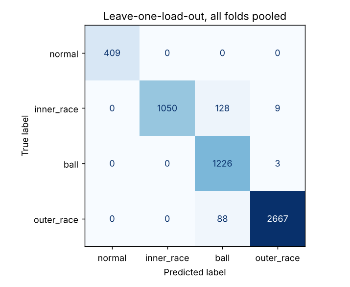
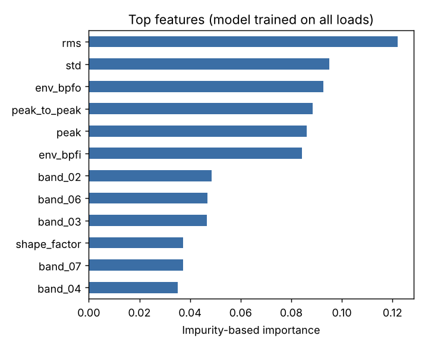

# Predictive maintenance example: bearing fault classification (CWRU)

Classifies the condition of a rolling bearing (normal, inner race fault,
ball fault, outer race fault) from the drive-end accelerometer of the
[CWRU Bearing Data Center](https://engineering.case.edu/bearingdatacenter)
test rig, using features computed with `modelgen.signal.features` and a
RandomForest from `modelgen.ml`.

## Pipeline

1. **Windowing**: each recording (48 kHz) is cut into windows of 8192
   samples (about 0.17 s, five shaft revolutions) with 50% overlap.
2. **Features** (24 per window):
   - time domain: RMS, peak, peak-to-peak, crest factor, kurtosis, skewness,
     shape, impulse and clearance factors;
   - frequency domain: spectral centroid and relative energy in 8 bands;
   - envelope domain: amplitude of the envelope spectrum at the bearing
     defect frequencies (BPFI, BPFO, BSF, FTF) computed from the measured
     shaft speed and the geometry of the SKF 6205 bearing, divided by the
     median of the envelope spectrum.
3. **Model**: RandomForest, 300 trees, balanced class weights.
4. **Evaluation**: two protocols, see below.

## Data

56 recordings, 5,580 windows: 4 normal, 12 inner race, 12 ball and
28 outer race recordings (fault diameters 7, 14 and 21 mils, motor loads 0 to
3 hp). The raw `.mat` files are not stored here; `cwru_features.csv` holds
the extracted features so the experiment can be rerun without them.

## Results

| Features | Random split F1 | Leave-one-load-out F1 (mean / worst fold) |
|---|---|---|
| time + spectral (20) | 0.997 | 0.950 / 0.882 |
| time + spectral + envelope (24) | 0.999 | 0.952 / 0.910 |

F1 is macro-averaged over the four classes.

**Why two protocols.** With a random split, windows of the same recording,
which overlap by 50%, end up in both training and test sets, so the score
is close to perfect and says little about new data. Many published CWRU
results use this setup. In leave-one-load-out the model is trained on three
motor loads and tested on the fourth, which it has never seen, and no
recording is on both sides; the four folds are then averaged. The drop from
0.99 to 0.95 is the gap between the two protocols.

**What the numbers show.**
- Normal bearings are never confused with faulty ones on unseen loads
  (409/409 windows correct).
- The remaining errors are between fault types, mostly inner race windows
  predicted as ball faults.
- Envelope features improve the worst fold (0.882 to 0.910) and reduce inner
  race windows predicted as outer race (148 to 9), but leave the mean almost
  unchanged and increase inner race windows predicted as ball (20 to 128).
  The net gain is within the fold-to-fold variation.
- In the importance ranking, the envelope amplitudes at BPFO and BPFI sit
  next to RMS and peak among the top six features.




**Limits.** All recordings come from one test rig with seeded (machined)
defects, and the four loads are close in speed (1718 to 1797 rpm), so this
is not evidence of performance on another machine or on naturally developing
faults. Only 4 normal recordings are available.

## Reproduce

```bash
pip install -e .

# Optional: rebuild the features from the raw recordings
git clone --depth 1 https://github.com/s-whynot/CWRU-dataset data/cwru
python examples/predictive_maintenance/build_features.py \
    --data-dir data/cwru --out examples/predictive_maintenance/cwru_features.csv

# Run the experiment (about 20 s)
python examples/predictive_maintenance/run_experiment.py
```

The same features can be computed for any signal stored in a CSV:

```bash
modelgen features --input signal.csv --column acc --fs 48000 \
    --window 8192 --step 4096 --shaft-hz 29.9 --bearing cwru-6205-de \
    --label outer_race --out features.csv
```

Data source: Case Western Reserve University Bearing Data Center.
